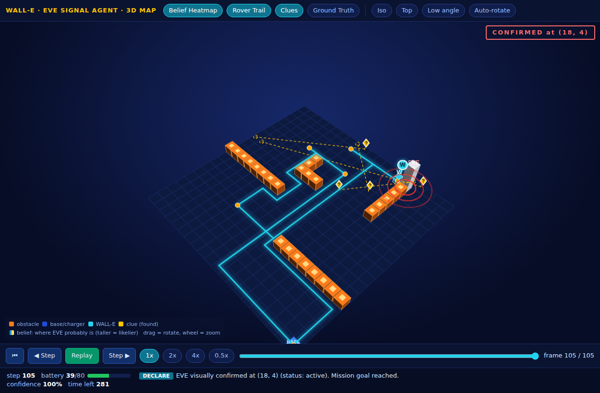
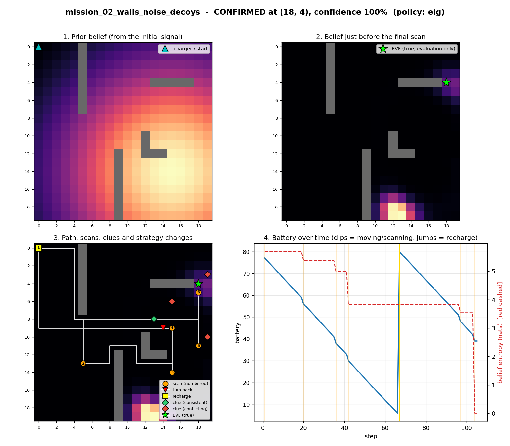
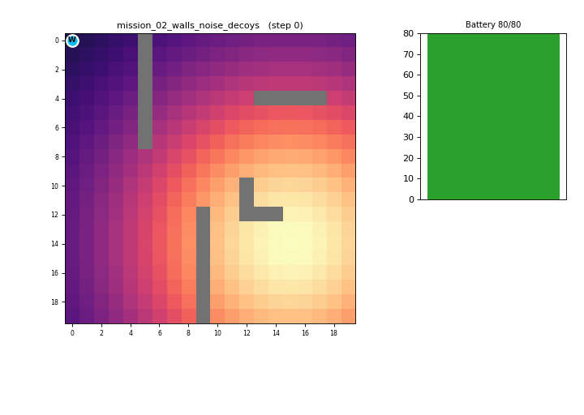
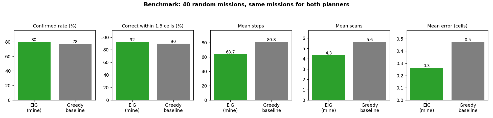

# WALL-E and EVE's Signal

**Project description.** An autonomous search agent for a simulated world. WALL-E must find EVE using only a vague initial
signal, noisy scans and hidden clues, under a limited battery and time budget. The agent keeps a Bayesian probability map of
EVE's location, picks the scan that teaches it the most per unit of battery, never goes where it cannot return from, turns
back and recharges when needed, logs every decision with its reasoning, and finishes with a mission report (evidence,
inferred location, confidence, recommended next step).

**Setup (30 seconds).** Python 3.9+ required.
```bash
pip install -r requirements.txt     # numpy, matplotlib, pyyaml
python run.py                       # opens the web control panel in your browser (press a mission's RUN button)
```
Command-line alternative: `python run.py configs/mission_02_walls_noise_decoys.yaml`

## Results at a glance
**3D map** (belief as rising columns, obstacles as glowing blocks, rover trail, clue pointers, EVE lock-on). Each mission has an
interactive, self-contained viewer: open `outputs/<mission>/map_3d.html` in any browser (no server or internet needed): drag to rotate,
wheel to zoom, play / pause / step / speed controls, and layer toggles (Belief Heatmap, Rover Trail, Clues, Ground Truth).
The same viewer is the first tab of the web control panel.



Path, scans, clues, turn-back/recharge points, belief heatmaps and battery/entropy (mission 02, the hard one):



Heartbeat-sensor style animation of the same mission: `outputs/mission_02_walls_noise_decoys/animation.gif`



Evaluation on 40 random missions (EIG planner vs greedy baseline), data in `outputs/benchmark/benchmark.csv`:



| Mission | Outcome | Steps | Notes |
|---|---|---|---|
| mission_01 (easy) | EVE confirmed at (19, 9) | 32 | no recharge needed |
| mission_02 (walls, noise, spoofs, decoys) | EVE confirmed at (18, 4) | 105 | one turn-back, one recharge |
| mission_03 (JSON, bearing + range) | EVE confirmed at (9, 4) | 50 | |

No model training is involved (the agent uses Bayesian inference), so there are no loss curves; the evaluation metrics are
the benchmark above and the per-mission `report.md`. A full written explanation is in `WALL-E_EVE_Project_Explained.pdf`.
Tests: `PYTHONPATH=. python tests/test_core.py` (Windows PowerShell: `$env:PYTHONPATH="."; python tests/test_core.py`).

---

## Easiest way: the web control panel
Press **Run** on `run.py` (or type `python run.py` with no arguments). Your browser opens a mission-control page with:
a button per mission (with a 3D map tab), a planner switch (EIG / Greedy), a seed box (new seed = EVE and clues hidden somewhere new),
an "also make animation" option, **Run all missions**, a planner **benchmark**, and **unit tests**.
Results (3D map, figure, heartbeat animation, step trace, ASCII map, report) show on the page. It uses only the standard library
and runs on your own machine (127.0.0.1). Stop it with Ctrl+C or the Quit button.

## Quick start (command line)
```bash
pip install -r requirements.txt
python run.py configs/mission_01.yaml            # easy demo
python run.py configs/mission_02_walls_noise_decoys.yaml -v   # walls, noise, spoofs, decoys, recharges
python run.py configs/mission_03_bearing.json    # JSON config, bearing+range signal
python run.py configs/mission_01.yaml --policy greedy         # baseline planner
python benchmark.py --n 40                       # random-mission benchmark, EIG vs greedy
PYTHONPATH=. python tests/test_core.py           # sanity tests
```
Each run writes to `outputs/<config name>/`: `trace.jsonl`, `report.md`, `report.json`,
`ascii_final.txt`, `mission_overview.png`, `config_used.json`.

## Environment design (`walle/env.py`)
* Grid world (default 20x20), 4-connected moves, obstacles from the config (explicit list or random density).
  The charger is at `start`. The map is known; **EVE and the clues are hidden**.
* Actions: `move` (adjacent cell), `scan`, `recharge` (only at the charger), `declare` (end mission).
* Costs: every action spends battery and time (see `costs`). Recharging restores full battery, costs time, and is limited by `max_recharges`.
* Scan observation: `reading = exp(-distance_to_EVE / length_scale) + gaussian noise`, optionally replaced by a random
  value with probability `spoof_prob` (spoofed signal). Clues within `scan_radius` are revealed (each only once);
  a clue points to an estimated EVE location, but decoy clues point somewhere random. If EVE is within `detect_radius`
  it is visually confirmed (position + status).
* The agent never receives ground truth. `Environment.truth()` is used only for post-mission evaluation.

## Config format (JSON or YAML)
| Key | Meaning |
|---|---|
| `seed` | makes map generation, EVE position (if not given) and clue placement reproducible |
| `map` | `width`, `height`, `obstacles: [[x,y],...]`, `obstacle_density` |
| `start` | start cell and charger location |
| `signal` | initial reading: `coords:[x,y]` **or** `bearing_deg`+`range`; `strength` 0..1; `timestamp` (older = vaguer) |
| `eve` | optional hidden `position` and `status` (random from seed if omitted) |
| `budget` | `battery`, `time`, `max_recharges` |
| `costs` | `move`, `scan`, `move_time`, `scan_time`, `recharge_time` |
| `sensor` | `length_scale`, `noise`, `spoof_prob`, `scan_radius`, `detect_radius` |
| `clues` | `count`, `decoy_prob`, `sigma`, or an explicit `list` of `{pos, kind, reliable}` |
| `agent` | `policy` (`eig`/`greedy`), `safety_margin`, `stop_confidence`, `decoy_prior` |

## Agent (`walle/agent.py`, `walle/belief.py`)
* **Belief**: a probability grid over EVE's location, initialised from the signal (Gaussian whose width grows when
  the signal is weak or old, plus 10% uniform mass in case the signal is wrong).
* **Bayesian updates**: scan reading (with spoof mixture), clues (reliable-vs-decoy mixture), and "scanned but EVE
  not seen" (removes mass near the scan point).
* **Where to go / what to scan**: for every reachable cell, utility = (expected information gain of scanning there +
  P(EVE within detection radius) x current entropy) / battery cost.
* **Recharge / turn back**: only cells from which WALL-E can still return to the charger with `safety_margin` spare
  battery are allowed. If none is affordable away from the charger the agent turns back; at the charger it recharges
  when a full battery would allow a clearly better scan (>= 1.3x utility), otherwise it reports.
* **Stop**: EVE confirmed, belief converged (`stop_confidence`), or resources exhausted.

## Trace and report
`trace.jsonl` has one JSON object per action: step, time left, battery, position, action, decision tag
(`replan`, `move`, `scan`, `turn_back`, `recharge`, `declare`), reasoning text, observation and a belief summary.
`report.md` lists evidence (readings, clues with a consistent/conflicting verdict, outlier readings that look spoofed),
the inferred location, status, confidence, a recommended next step, and an evaluation-only comparison to ground truth.

## Bonus items implemented
ASCII map + 4-panel matplotlib figure (path, clues, strategy changes, battery/entropy), noisy sensors, spoofed
signals and decoy clues, and a generalisation benchmark over random missions with a classical greedy baseline.
Not implemented: 3D/physics simulation, multi-agent coordination, LLM-vs-planner comparison.

## Animation (heartbeat-sensor style)
```bash
python animate.py configs/mission_01.yaml                 # writes outputs/<name>/animation.gif
python animate.py configs/mission_02_walls_noise_decoys.yaml --fps 10
```
Each scan sends out an expanding ping ring from WALL-E (brighter ring = stronger signal return). The belief glows green
like heartbeat blips, a pulsing blip marks the current best estimate, and EVE is "locked" with a red pulse when confirmed.
`animate_classic.py` gives the plain version.
